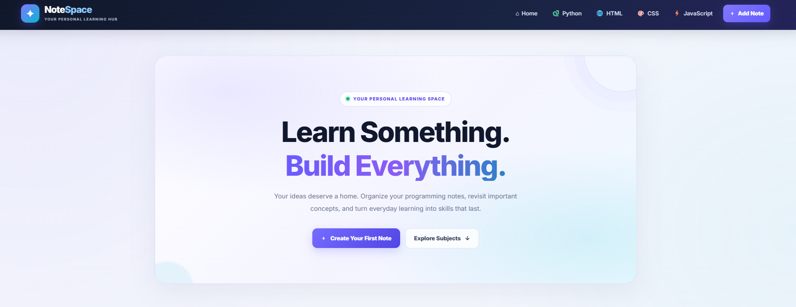
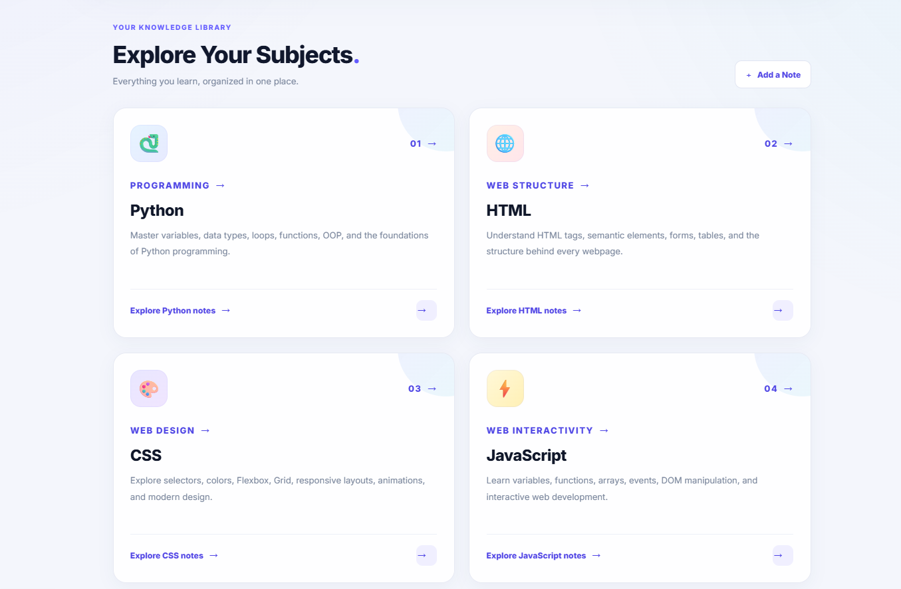
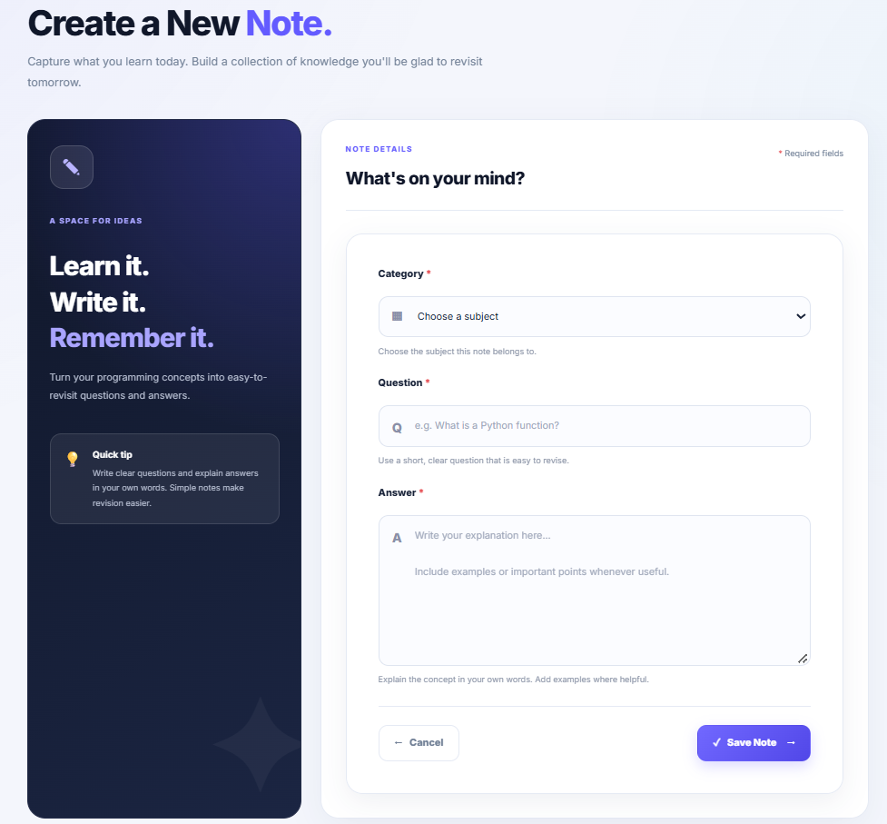
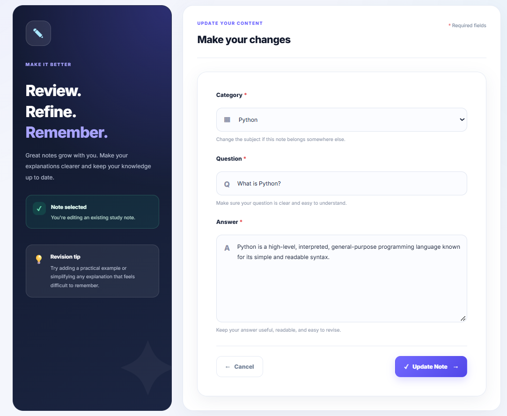

# 📝 NoteSpace — Notes Management System

NoteSpace is a simple and user-friendly Notes Management System built with Python and Django. It helps users create, view, edit, and delete notes, organized by categories such as Python, HTML, CSS, and JavaScript.

## 📸 Screenshots

### 🏠 Home Page


### 📚 Notes Category


### ➕ Create a Note


### ✏️ Update a Note


## ✨ Features

- Create new notes.
- View notes on the home page.
- Organize notes by category.
- Edit existing notes.
- Delete notes.
- Navigate between Python, HTML, CSS, and JavaScript categories.
- Responsive and user-friendly interface.

## 🛠️ Technologies Used

- **Backend:** Python, Django
- **Frontend:** HTML5, CSS3
- **Database:** SQLite
- **Tools:** Git, GitHub, Visual Studio Code

## 📂 Project Structure

```text
notes-management-system/
├── notes/
├── notes_project/
├── static/
│   └── css/
│       └── style.css
├── templates/
│   ├── base.html
│   ├── home.html
│   ├── category.html
│   ├── add_note.html
│   └── edit_note.html
├── screenshots/
│   ├── home.png
│   ├── category.png
│   ├── create_note.png
│   └── update_note.png
├── manage.py
├── requirements.txt
├── .gitignore
└── README.md
```

## ⚙️ Installation and Setup

### 1. Clone the repository

```bash
git clone https://github.com/Thanuja1201/notes-management-system.git
```

### 2. Navigate to the project directory

```bash
cd notes-management-system
```

### 3. Create a virtual environment

```bash
python -m venv venv
```

Activate it on Windows:

```powershell
.\venv\Scripts\Activate.ps1
```

### 4. Install dependencies

```bash
pip install -r requirements.txt
```

### 5. Apply database migrations

```bash
python manage.py migrate
```

### 6. Start the development server

```bash
python manage.py runserver
```

Open the application in your browser:

http://127.0.0.1:8000/

## 🎯 Learning Outcomes

Through this project, I practised:

- Developing a web application using Django.
- Implementing CRUD (Create, Read, Update, Delete) operations.
- Working with Django models, views, templates, and URL routing.
- Using SQLite for data storage.
- Designing web pages with HTML and CSS.
- Managing project code using Git and GitHub.

## 🚀 Future Improvements

- Add user registration and login.
- Add note search functionality.
- Improve category management.
- Deploy the application online.

## 👩‍💻 Developer

**Thanuja Nallabothula**

- **GitHub:** [Thanuja1201](https://github.com/Thanuja1201)
- **LinkedIn:** [Connect with me](https://www.linkedin.com/in/thanuja-nallabothula-928452391/)

---

⭐ If you find this project useful, feel free to explore the repository!